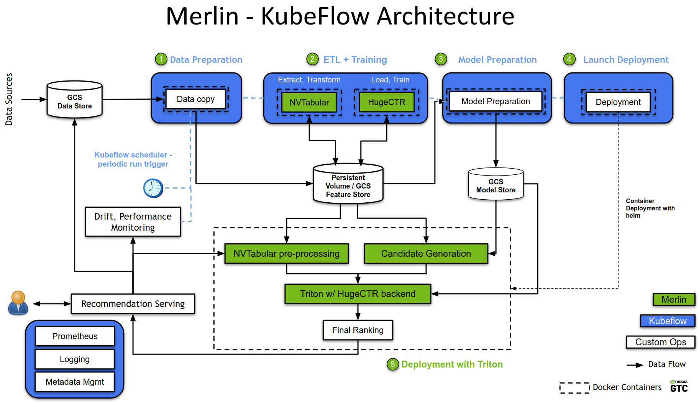

# Merlin - MLOps on GKE

## Introduction
[NVIDIA Merlin](https://developer.nvidia.com/nvidia-merlin) is an open-source application framework that facilitates the development and deployment of large-scale deep recommender systems on GPUs.

The figure below shows the architecture of a recommendation system example using NVIDIA Merlin on a [Kubeflow pipeline](https://www.kubeflow.org/docs/components/pipelines/overview/pipelines-overview/).

Through this, we intend to show an end-to-end reference architecture, all the way from data preparation, to model deployment, with features like continuous and fast re-training, autoscaling, and model monitoring.

For this example, we use the [Criteo 1TB Click Logs](https://ailab.criteo.com/download-criteo-1tb-click-logs-dataset/) dataset, a large publicly available dataset for recommender systems. It contains feature values and click feedback for millions of display ads. It is divided into 24 files, each one corresponding to one day of data.

## Authentication and workload identity

The containers do not include long-lived cloud credential files. Build and push
them using the operator's existing Docker and Google Cloud authentication, and
run workloads on GKE with
[Workload Identity Federation](https://cloud.google.com/kubernetes-engine/docs/how-to/workload-identity).

Before running the pipeline:

1. Configure the Kubeflow pipeline worker's Kubernetes service account to use a
   least-privileged Google service account. Pipeline components need only the
   permissions required for their storage, cluster, and deployment operations.
2. Create a Kubernetes service account for the deployed Triton and monitoring
   workloads, bind it to a least-privileged Google service account, and pass its
   name through the `workload_service_account` pipeline parameter. The default
   name is `mlops-workload`.
3. Set the `kfp_host` pipeline parameter to the Kubeflow Pipelines API
   endpoint. It is supplied to the monitoring pod at deployment time instead of
   being stored in a container image.
4. Grant the monitoring identity subscriber access only to its required Pub/Sub
   subscription and grant each workload access only to its required storage
   objects.
5. Use only immutable image digest references for deployed workloads. The build
   scripts print the pushed digest; pass a digest reference through the
   `triton_image` pipeline parameter as well.

## Running the example
Please follow the User Guide available [here](https://docs.google.com/document/d/1P_BerGSP5CNzGjGbRqgMrPcNaCmQuKUyodFaG0jlu9I/edit?usp=sharing)!

